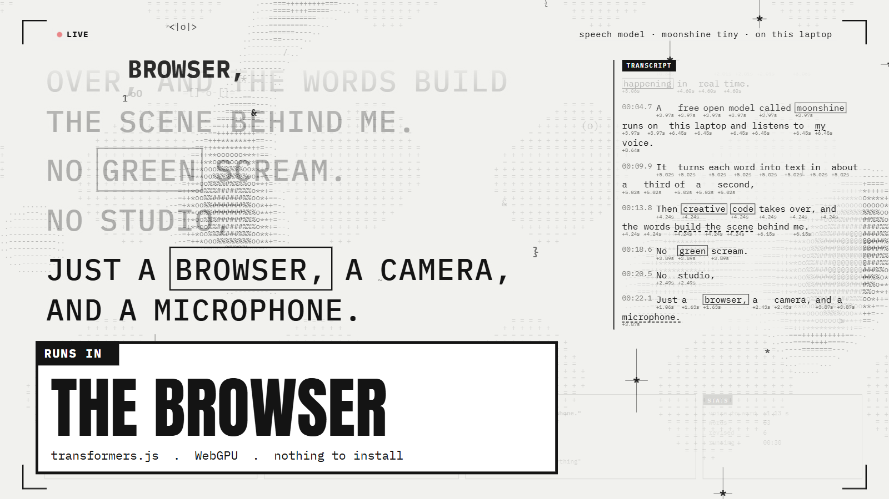

# Live Words

A live stage for talking: you speak, and your words type out over an ASCII scene as you say them.
A transcript runs down the side, and lower-third cards pop up when you say certain keywords.
Inspired by kem_glitch's reel, minus the green screen and person cutout.

**Try it:** https://roblineker.github.io/live-words/ (Chrome or Edge, allow the mic)

## Run it

Locally: double-click `start.cmd` (it needs Node), or run `node server.mjs` and open http://127.0.0.1:5177 in Chrome or Edge.

Pick an engine and press START.

| Engine | Where it runs | Notes |
| --- | --- | --- |
| Moonshine Base | this laptop (WebGPU, WASM fallback) | most accurate. The first run downloads the model, which is then cached |
| Moonshine Tiny | this laptop | fastest, a bit less accurate |
| Browser speech | Google/Microsoft cloud via Chrome/Edge | no download, handles accents well, not local |

"Runs on" picks GPU (WebGPU) or CPU (WASM, multi-threaded thanks to the isolation headers `server.mjs` sends).

"Demo recording" plays `demo.wav` through the pipeline so you can see it working without a mic.

## Keys

| Key | Does |
| --- | --- |
| Space | pause / listen |
| → / PgDn | next card |
| ← / PgUp | previous card |
| Esc / . / B | hide card |
| H | hide HUD and frame |
| T | hide transcript (the stage goes full width) |
| C | camera on/off, drawn as ASCII art in the background |
| X | clear the stage |
| F | fullscreen |

PgUp/PgDn/Esc/B are what presenter clickers send, so a clicker steps through the cards.

## Design panel (D)

Press **D** any time (even before START) for dials and sliders that restyle everything live:

- **Scene:** speed, blob amount, blob size, voice reactivity, grid size, ink strength, texture, glyphs, crosshairs, stamped words, frame rate, the character set, the font
- **Camera:** on/off, strength, contrast, brightness, trails, style (blend / camera only / edges / edges + fill), position (full / left / right / centre), posterise, invert, mirror
- **Colour:** paper, ink, live dot, card, card ink
- **Words:** size, spacing, how often words get boxed / serif / inverted, font, phrases on stage, stage width and position, uppercase, glow, cursor
- **Panels:** card size, font and how long cards stay up, transcript size and width, HUD opacity, frame

Presets: Paper, Terminal, Blueprint, Riso, Night (full looks) and Calm, Chaos (motion only, keeps your colours).
"save as..." stores your own looks, and copy/paste JSON moves a look between machines. Settings save automatically.
Dials: drag up/down (Shift = fine), scroll, or arrow keys. Double-click any control to reset it.

## Performance log

While running, the page posts a summary every 5 s to `logs/perf-<date>.jsonl`: frame rate and draw time,
model time for live and final passes, real-time factor (processing seconds per second of audio), the delay
from the end of speech to the final text, queue wait, skipped live passes, long tasks and errors.

If the model falls behind (real-time factor above 0.9), live passes pause so the finals keep up, and the
top-right label warns you. On this laptop that happens when Paseo and other apps are using the CPU heavily.
For a live talk, close heavy apps or use **Browser speech**.

## Your cards

Edit `cues.js`. Each card has `say` (keywords that trigger it), `tag`, `title`, `sub` and an optional `hold`.
A card with an empty `say` only shows when you step to it by hand.

## How it works

- `capture-worklet.js` chops the mic into 32 ms frames at 16 kHz.
- `app.js` detects when you start and stop talking (an adaptive noise floor). While you talk it
  re-transcribes the growing phrase about every 0.3 s, and words that change between passes are
  shown as revisions. After 650 ms of quiet the phrase is finalised.
- `asr-worker.js` runs Moonshine through transformers.js in a worker, so the animation never stalls.
- `ascii-bg.js` draws the scene: a drifting density field that reacts to your voice, floating glyphs,
  crosshairs, finished phrases stamped into the background, and the optional camera as characters.

The page uses Google Fonts (Anton, IBM Plex Mono, Instrument Serif), so the first load needs internet.
After that, Moonshine works offline once cached.
